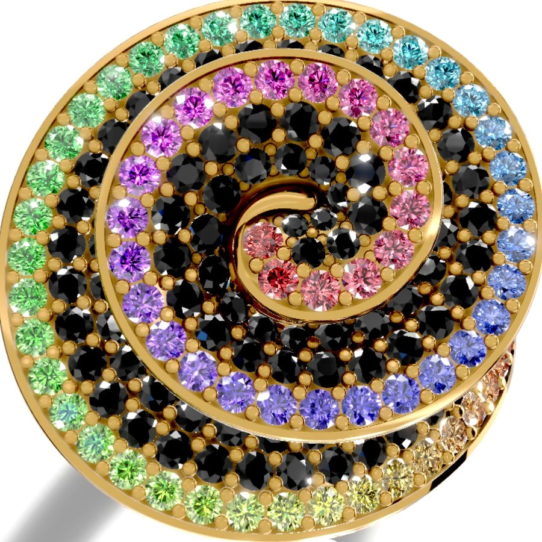
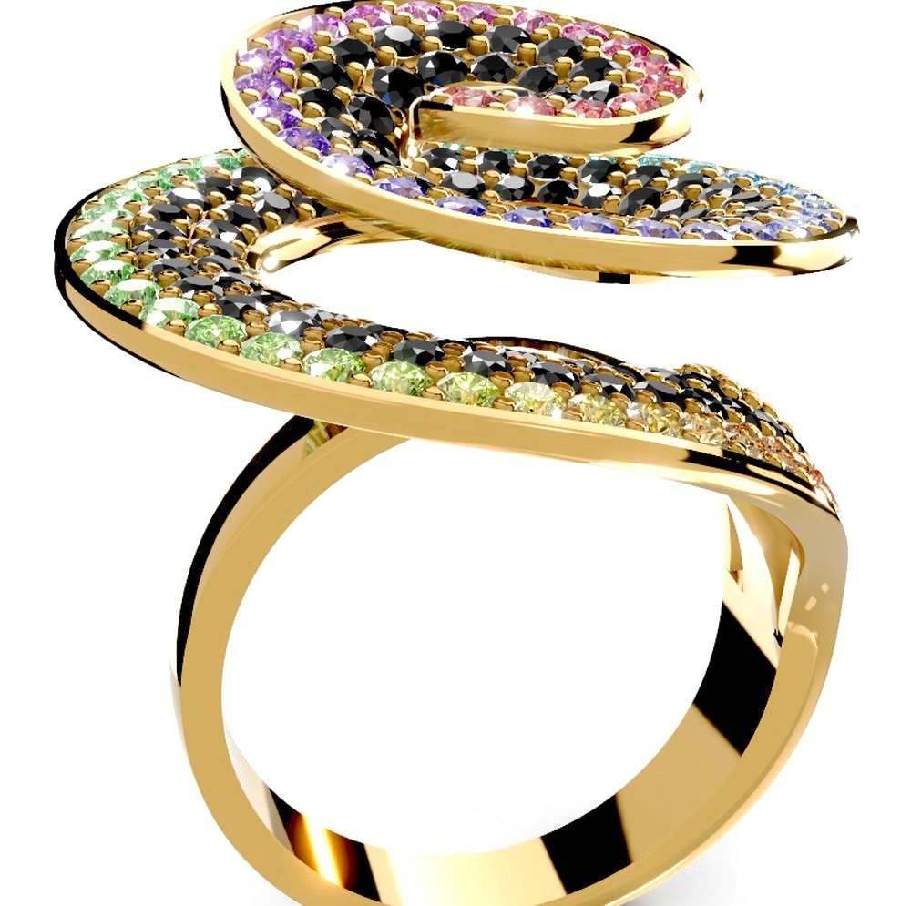
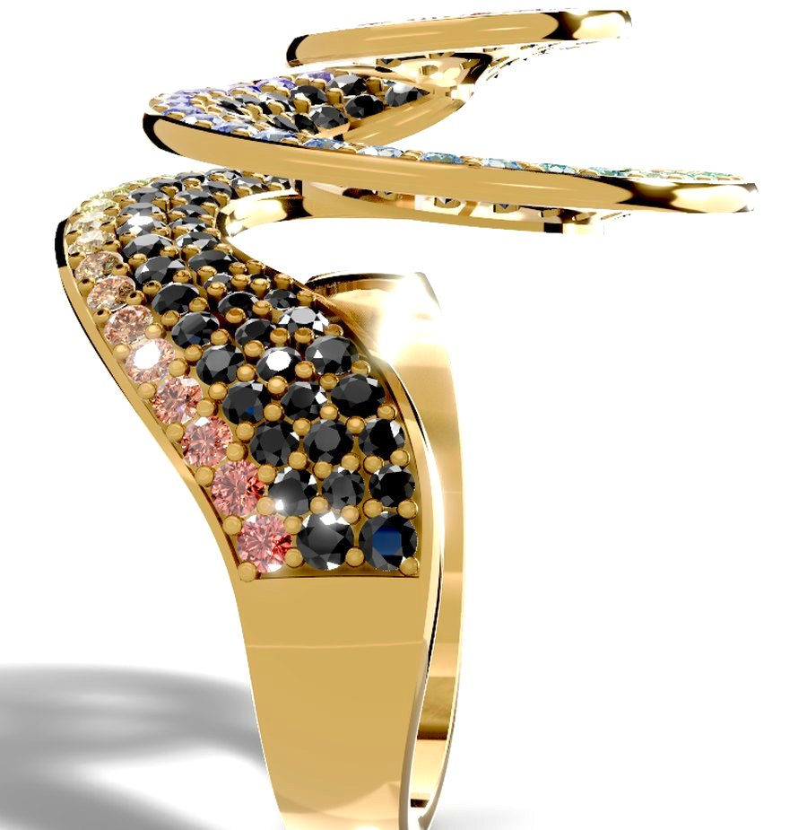
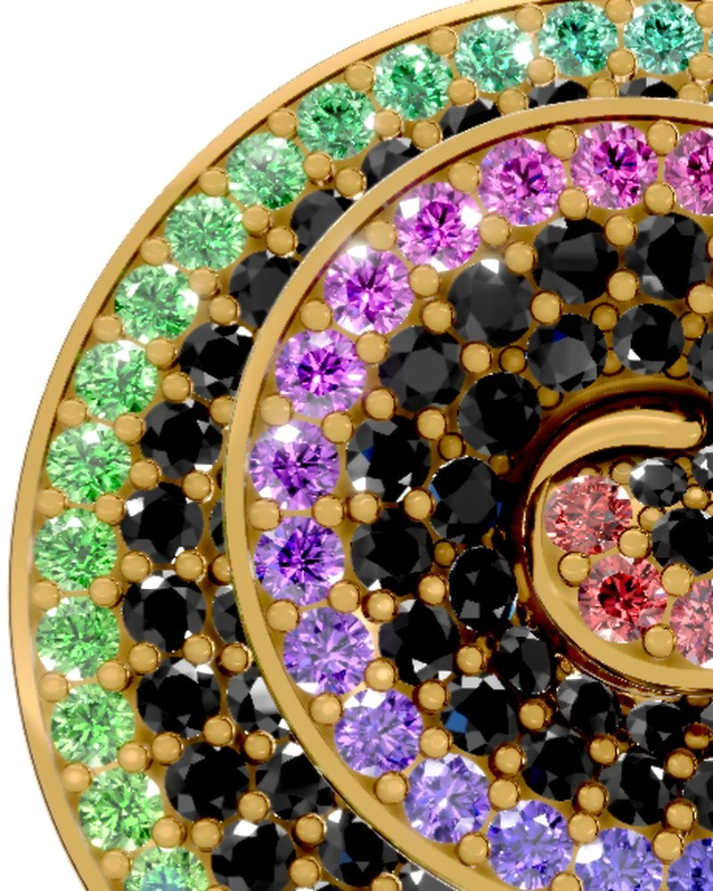
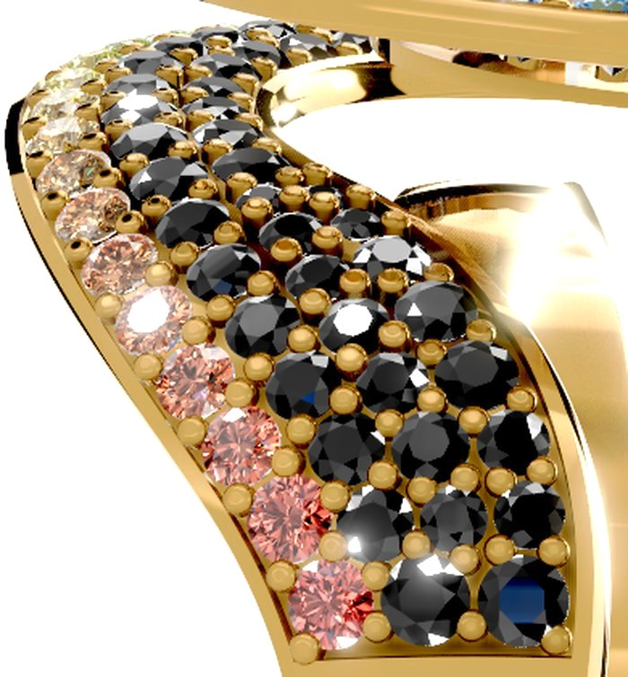

# The Spiral — A Single Ring

A presentation site for a single bespoke ring: a spiral of graded colour stones and black stones, coiled in gold.

## Ring Images Showcase

| Image | View | Location in Site |
|---|---|---|
|  | **From Above** | Hero Arch Medal (`#top`) & View 01 (`#piece`) |
|  | **Face On** | View 02 (`#piece`) & Band Detail (`#details`) |
|  | **In Profile** | View 03 (`#piece`) |
|  | **The Colour** | Detail Item II (`#details`) |
|  | **Black Stones** | Detail Item III (`#details`) |

## Asset Directory Structure

All ring images live in [`images/`](images/):
- `images/ring-top.jpg` — 900x900px top-down shot of spiral
- `images/ring-front.jpg` — 1000x995px face-on elevation of crown & band
- `images/ring-side.jpg` — 900x925px profile curve of the shank
- `images/detail-colour.jpg` — 800x1000px macro closeup of gradient rainbow stones
- `images/detail-black.jpg` — 700x754px macro closeup of black stones

To replace images: keep filename and aspect ratio, drop replacement into `images/`.
